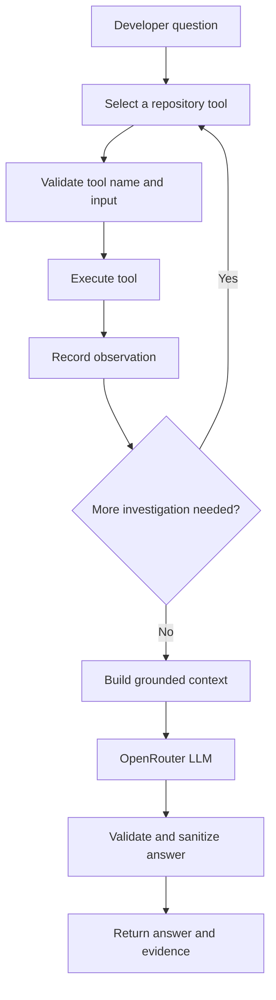

# Agent Workflow

## Overview

CodeMind uses LangGraph to coordinate an agent that investigates repository questions using a bounded set of repository tools.

The agent is not intended to execute arbitrary shell commands or autonomously modify source files. Its repository operations are mediated by application tools and validation logic.

## Conceptual workflow

## Agent state

The state includes:
- User query
- Repository path
- Top-K retrieval setting
- Selected tool and tool input
- Tool result
- Investigation observations
- Iteration and maximum-iteration counters
- Final answer
- Errors

## Repository tools

The current allowlist includes:
- `search_symbols`
- `find_symbol`
- `get_source`
- `analyze_change`
- `hybrid_search`

The tool schemas and exact accepted arguments are defined in the agent tool definitions and guardrails modules. Use those files as the implementation source of truth.

## Guardrails

The implementation includes:
- Allowlisting of tool names
- Validation of tool inputs
- Repository path validation
- Source-range limits
- Prompt-injection pattern detection in untrusted tool output
- Likely-secret redaction
- Output validation and sanitization

Guardrails reduce risk but cannot guarantee detection of every malicious instruction or secret.

## RAG answer generation

Tool observations are assembled into a context object and passed through the RAG prompt builder. The prompt instructs the model to ground claims in repository evidence and acknowledge insufficient evidence.

LLM output quality depends on retrieval quality, available observations, context limits, and the configured model. Review generated answers before using them to make production changes.

## OpenRouter configuration

Set `OPENROUTER_API_KEY` in the local environment. The model identifier is configured through the project's supported environment settings. Never hardcode secrets in the repository.

## Current limitations

- Tool selection and answer generation depend on the LLM provider.
- Import/dependency analysis is best-effort.
- Retrieved context is bounded and may omit relevant code if the repository is large.
- An answer is only as reliable as the evidence returned by the tools.
- The current toolset is read-oriented; do not assume source-editing functionality.
