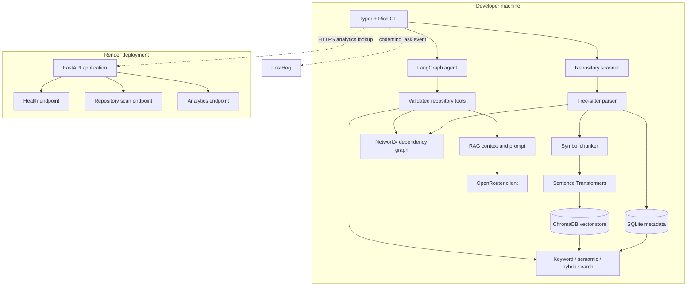
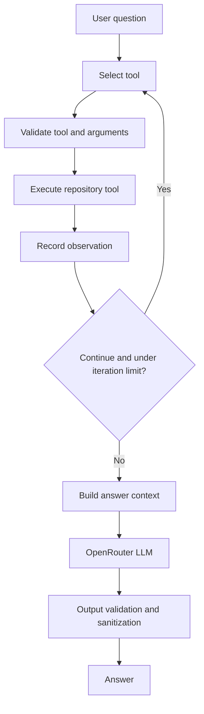

# Architecture

## System overview

CodeMind consists of a local developer workflow and a separately hosted FastAPI service.

## Responsibilities

| Package | Responsibility |
|---|---|
| `scanner` | Walks repository directories, excludes generated directories, detects file languages, and returns file metadata |
| `parser` | Parses supported Python and Java files and extracts symbols, imports, calls, and parse errors |
| `database` | Stores repository, source-file, symbol, import, and call metadata in SQLite |
| `indexer` | Coordinates structural indexing and semantic indexing |
| `chunking` | Extracts symbol-level code chunks |
| `embeddings` | Generates vector representations with Sentence Transformers |
| `vectorstore` | Stores and retrieves embeddings through ChromaDB |
| `search` | Keyword, semantic, hybrid retrieval, and evaluation |
| `graph` | Represents dependency relationships with NetworkX |
| `rag` | Builds bounded retrieved context and LLM prompts |
| `agent` | LangGraph state, tool selection, execution, observations, and guardrails |
| `llm` | OpenRouter client |
| `api` | FastAPI app, routes, dependencies, and request analytics |
| `telemetry.py` | Optional PostHog `codemind_ask` event |
| `cli` | Typer commands and Rich terminal presentation |

## Structural indexing flow

1. The CLI invokes the repository scanner.
2. The scanner returns candidate files and language metadata.
3. The indexer selects supported source extensions.
4. Tree-sitter extracts symbols, imports, calls, and parse errors.
5. The SQLite repository persists repository and file metadata and replaces extracted child records when a file is re-indexed.

## Semantic indexing flow

1. Supported source files are parsed.
2. `CodeChunker` extracts source ranges for symbols.
3. The embedding service creates normalized embeddings.
4. ChromaDB stores chunk text, vector, document ID, and metadata.
5. A successful complete indexing pass can remove stale vector IDs.

The documented semantic index extensions are `.py` and `.java`.

## Retrieval flow

- Keyword search queries SQLite symbol metadata.
- Semantic search embeds the query and searches ChromaDB.
- Hybrid search merges keyword and semantic results using Reciprocal Rank Fusion.

SQLite and ChromaDB are complementary stores, not interchangeable databases.

## Agent flow

The agent state tracks the query, repository path, retrieval depth, selected tool, tool input/result, observations, iteration count, answer, and errors. Available tool names in the current implementation include `search_symbols`, `find_symbol`, `get_source`, `analyze_change`, and `hybrid_search`.

## Dependency graph

The dependency service builds a directed NetworkX graph from import relationships. Impact analysis follows reverse dependency relationships to find potential dependents of a changed file. Import resolution is best-effort and should not be treated as a complete compiler or build-system dependency model.

## Local and hosted boundary

The local CLI owns local repository scanning, indexing, local SQLite/ChromaDB data, and agent operations. Render hosts the FastAPI application. The hosted service cannot access arbitrary folders on a developer's computer merely because a local path is sent in an HTTP request.

## External services

- OpenRouter receives LLM messages and the context assembled for a request.
- PostHog receives the optional CLI usage event.
- Render runs the FastAPI service.

See [Privacy and Security](privacy-and-security.md).
